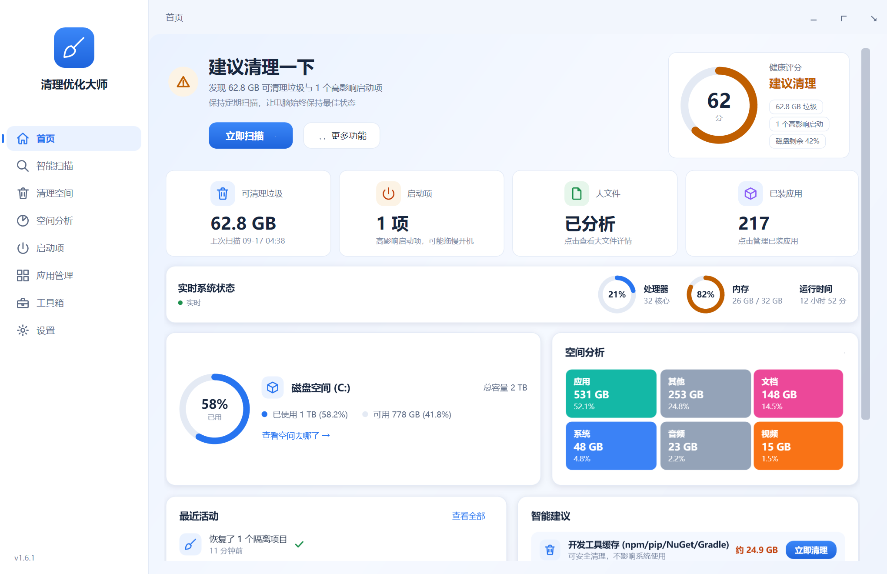
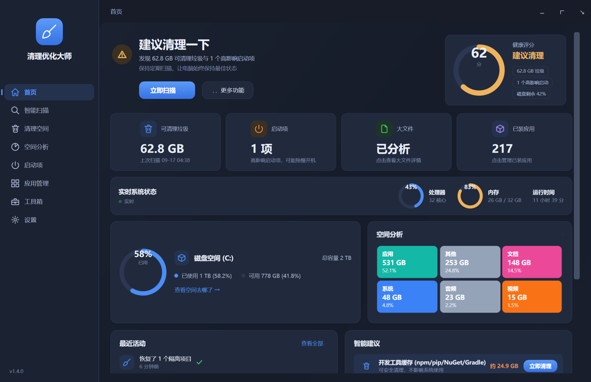
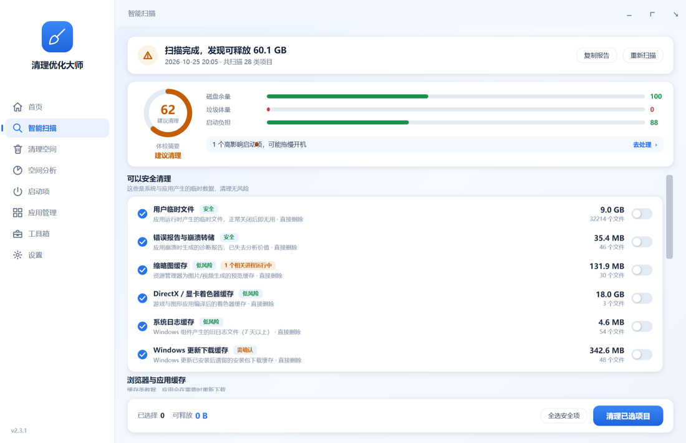
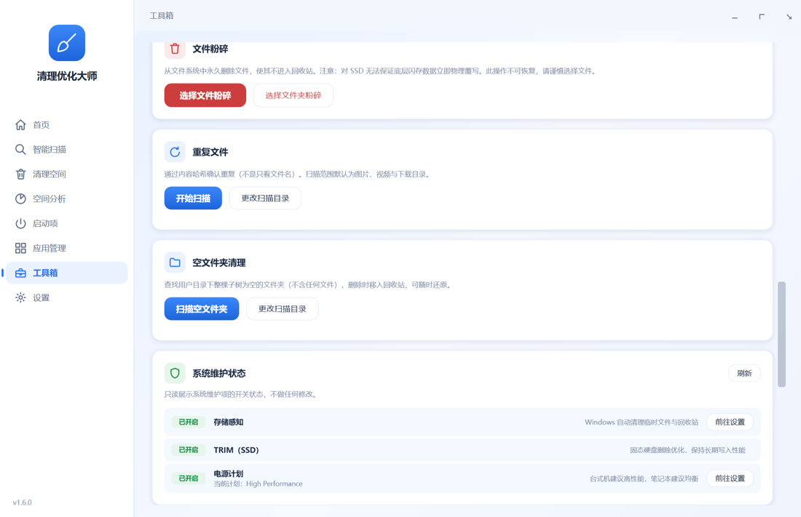

<div align="center">

# 🧹 CleanMaster for Windows

**A safe, transparent and restorable cleaner & system optimizer for Windows**

[](../../releases/latest)
[](LICENSE)
[](#-getting-started)
[](#-getting-started)

[简体中文](README.md) | [English](README.en.md) | [繁體中文](README.zh-TW.md) | [日本語](README.ja.md)

**Clean with clarity, optimize with confidence** — explainable, previewable, restorable. No fake boosts.

[⬇️ Download](../../releases/latest) · [🛠 Build from source](#-getting-started) · [💬 Contact](#-contact)

</div>

---

## ✨ Screenshots

| Light | Dark |
|---|---|
|  |  |

| Health check | Toolbox |
|---|---|
|  |  |

## ⬇️ Download

Grab the latest build from [Releases](../../releases/latest) (SHA256 checksums in `SHA256SUMS.txt`):

| File | For whom |
|---|---|
| `CleanMasterSetup-x.x.x.exe` | Most users: Chinese setup wizard with uninstaller |
| `CleanMaster-x.x.x-win-x64.zip` | Portable: unzip and run, no .NET runtime required (self-contained) |

## 🧰 Features

| Module | Capabilities |
|---|---|
| **Home** | Health score (disk / junk / startup factors, ring gauge with level colors), live CPU & memory monitors, disk ring gauge, 7-day cleanup stats chart, recent activity, one-click smart suggestions |
| **Health check** | Check-up home (last score) → scan → summary (score ring + factor bars + action items: high-impact startups / maintenance off) → clean → before/after score; copy report to clipboard |
| **Smart scan** | System junk / browser caches / app caches / recycle bin in one pass; results grouped by risk, per-item file details, right-click reveal / copy path |
| **Clean space** | System junk (temp, crash dumps, thumbnails, shader caches, update caches…), app caches (WeChat / QQ / Discord / Teams / Steam / Epic / VS Code / JetBrains, 13 catalogs), browsers (Edge / Chrome / Brave / Opera / Firefox), privacy traces (off by default), recycle bin, **custom clean folders** (user-added, double-guarded) |
| **Space analysis** | Multi-threaded full-disk scan, category stats, folder-size tree, large files (size + **type filter**, reveal / recycle / whitelist) |
| **Startup** | Registry Run / startup folders / logon scheduled tasks; toggles match Task Manager; boot duration (official event source); every change reversible |
| **Apps** | Full uninstall-table enumeration, native uninstallers, deterministic leftover detection after uninstall (quarantined, restorable) |
| **Toolbox** | Quarantine, file shredder, duplicate finder (content hash, cancellable), empty folder cleanup, history, system maintenance status (Storage Sense / TRIM / power plan, read-only), DNS flush, Windows shortcuts |
| **Productivity** | `Ctrl+K` command palette (search pages / tools / actions), `Ctrl+1..8` navigation, `Esc` cancels scans, global context menus |
| **Integration** | Light / dark / system theme, 8 UI languages, tray (follows UI language), window position memory, first-run wizard, auto-clean schedule, low-disk reminder, in-app update check |

## 🔒 Safety by Design

- **Central delete guard**: every deletion passes `SafetyGuard`; Desktop, Documents, Pictures, Downloads, System32, WinSxS, Program Files and more are hard-denied for every rule
- **Four risk levels**: only Safe / Low-risk items are pre-selected; Recycle Bin, update cache and privacy traces are never auto-selected
- **Restorable quarantine**: non-cache files go to quarantine first (30 days by default), restorable anytime with conflict handling
- **No junction traversal**: scanning and deletion never follow Junctions / symbolic links
- **Explainable**: every rule states why it is safe to clean, what the impact is, whether it is restorable, and which processes are locking it
- **Automated safety self-test**: `CleanMaster.exe --selftest` runs 15 groups of safety assertions (empty-folder detection, health-score grading, custom-folder boundary guard, boot-time service…) as a CI release gate

## 🚀 Getting Started

Requirements: Windows 10 22H2+ / Windows 11 and the [.NET 8 SDK](https://dotnet.microsoft.com/download/dotnet/8.0). Zero third-party NuGet dependencies.

```bash
git clone https://github.com/smftec/cleanmaster-windows.git
cd cleanmaster-windows
dotnet build src/CleanMaster.App/CleanMaster.App.csproj -c Release
# Run
src/CleanMaster.App/bin/Release/net8.0-windows/CleanMaster.exe
# Safety self-test
src/CleanMaster.App/bin/Release/net8.0-windows/CleanMaster.exe --selftest
```

Pushing a `v*` tag triggers GitHub Actions: build → safety self-test → publish → installer → checksums → draft Release.

## 📦 Packaging

```powershell
powershell -NoProfile -ExecutionPolicy Bypass -File scripts\publish.ps1
```

Produces the portable folder, a zip, a Chinese installer (auto-detects [Inno Setup](https://jrsoftware.org/isinfo.php), see [scripts/setup.iss](scripts/setup.iss)) and `SHA256SUMS.txt`.

With a code signing certificate, add two environment variables to emit signed artifacts:

```powershell
$env:CM_SIGN = "1"; $env:CM_SIGN_SUBJECT = "CN=Your Name"
powershell -File scripts\publish.ps1
```

## 🗺️ Roadmap

- [ ] SignPath Foundation open-source signing (in progress)
- [ ] Online cleaning-rule updates with signature verification
- [ ] Boot-time profiling with real measurements (ETW)
- [ ] Microsoft Store distribution

## 💬 Contact

- 🌐 Website: <https://52xn.com>
- 📮 Email: <dev@52xn.com>
- 💚 WeChat Official Account: search "**AI虚拟助理**" in WeChat

<div align="center">
  
</div>

## 📄 License

Released under **GPL-3.0** (see [LICENSE](LICENSE)): free to use, modify and redistribute; derivatives must remain open source. For commercial / proprietary licensing contact <dev@52xn.com>.

Code signing for release artifacts is provided free of charge by [SignPath Foundation](https://signpath.org) for open-source projects (integration in progress).
